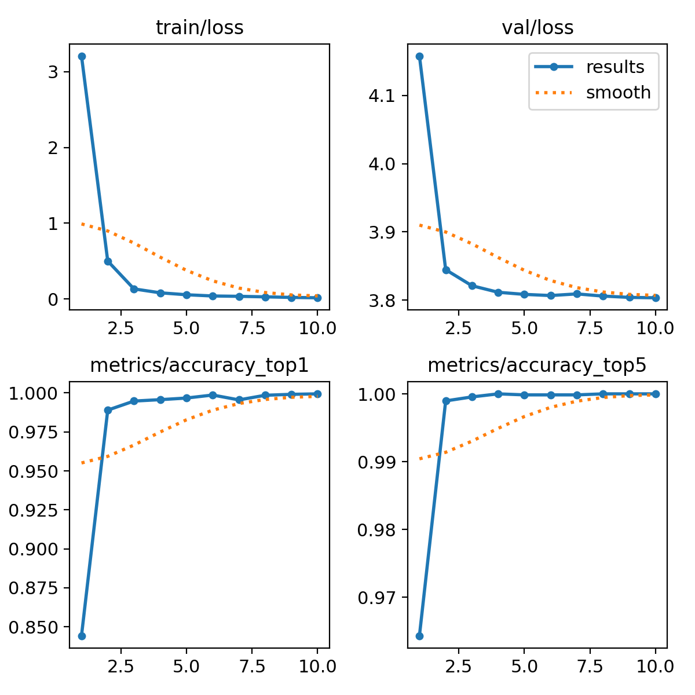
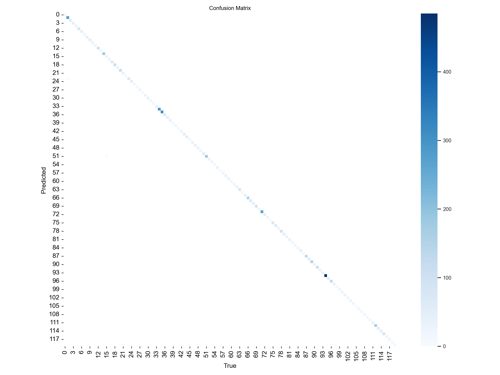
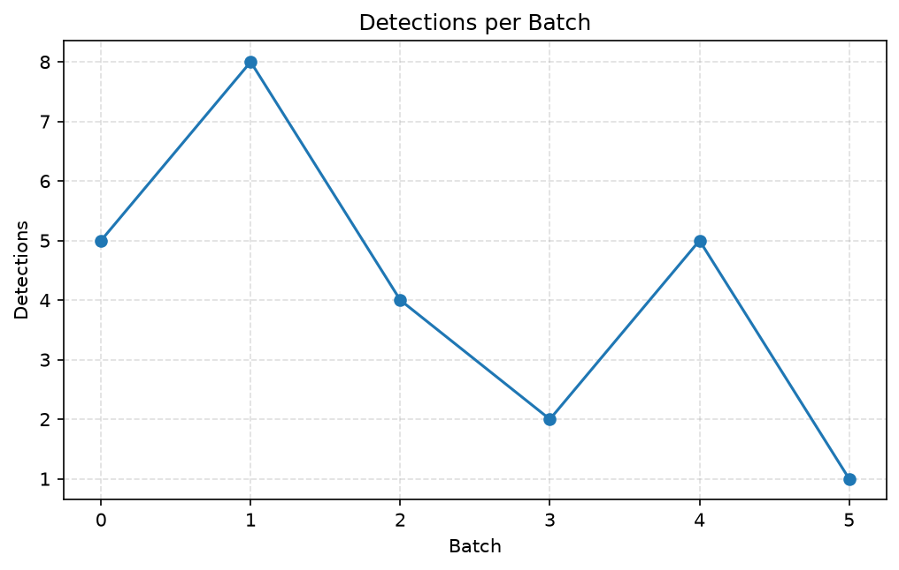
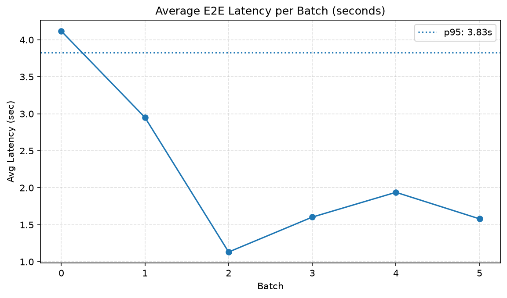
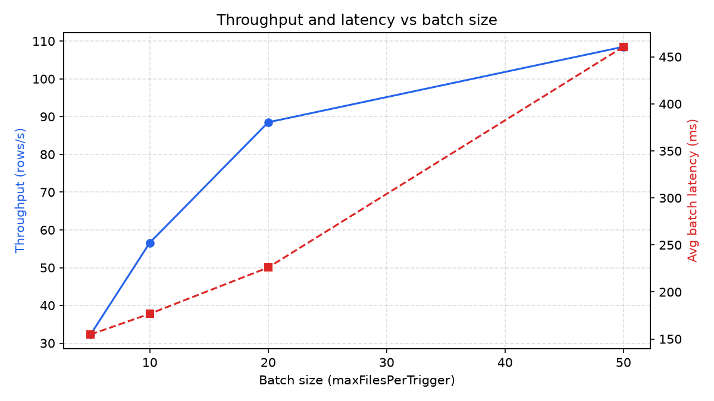
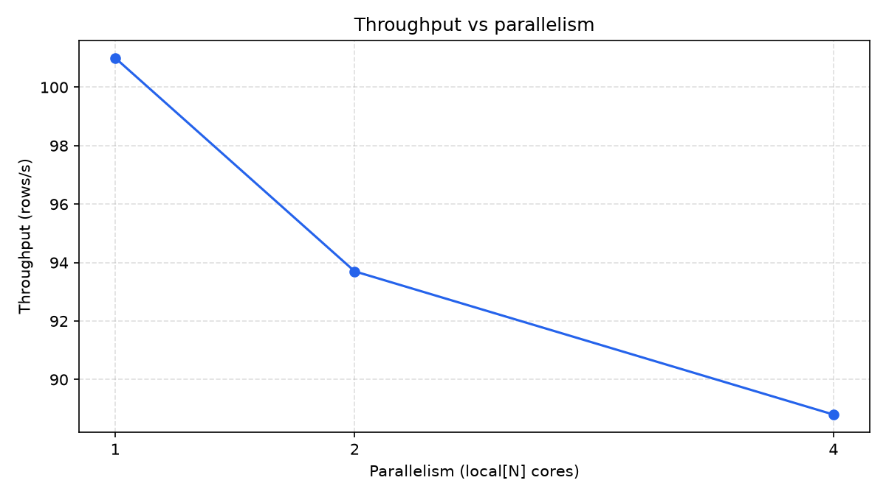

# Real-Time Grocery Stock Analysis

Identify grocery products from shelf camera feeds in real time and track them with a PySpark streaming pipeline.

## Overview

Stores want to know what is on their shelves and when something is about to run out. This project is a prototype of that, built on the GroZi-120 dataset, which has images of 120 grocery products. It puts a computer vision model and a stream processing engine together into one pipeline.

Simulated camera feeds send a steady stream of shelf images. A YOLOv8 model that was fine-tuned on GroZi-120 looks at each image and names the product it sees (it gets about 99.9% of the validation images right). Every detection is saved as a small JSON record, and PySpark reads those records as they arrive and works out running numbers: how many items were seen, which products, how confident the model was, and how long each one took to go from detection to processing. The streaming processor saves its progress as it goes, so if it crashes it starts back up where it stopped instead of losing or repeating work. The numbers are then turned into charts.

## How it works

There are four stages, and they talk to each other through files rather than being wired together directly. That keeps detection and processing separate, the same way a real setup might run detection on a camera and the number-crunching somewhere else.

1. **Feed simulation** (`feed_simulator.py`) copies dataset images into `stream_input/` on a timed interval, to stand in for a few cameras running at once.
2. **Detection** (`realtime_grozi_pipeline.py`) runs the YOLOv8 classifier on each new image and writes a JSON detection (product name, UPC barcode, confidence, timestamp) into `stream_output_json/`.
3. **Stream processing** (`pyspark_stream_processor.py` or `pyspark_simple_processor.py`) reads those JSON files in small batches and logs the per-batch metrics, with checkpointing so it can recover after a crash.
4. **Visualization** (`visualize_metrics.py`) reads the metrics log and draws the charts.

So the flow is: feed simulator writes images, the detection pipeline turns images into JSON, the PySpark processor turns JSON into metrics, and the visualizer turns metrics into charts.

## Requirements
- Python 3.11 or 3.12 (PyTorch / Ultralytics do not yet publish wheels for Python 3.14)
- pip
- A Java runtime (JDK 8, 11, or 17) on your PATH, required by the PySpark stage
- Python packages listed in `requirements.txt` (ultralytics, torch, torchvision, opencv-python, pyspark, pandas, numpy, matplotlib, pyyaml)

## Install dependencies
```bash
python -m venv venv
source venv/bin/activate      # Windows: venv\Scripts\activate
pip install --upgrade pip
pip install -r requirements.txt
```

## Dataset
The GroZi-120 `inSitu` images are not included in this repository. Download the
dataset and place the per-product `video` folders under `inSitu/` (e.g.
`inSitu/1/video/`, `inSitu/14/video/`, ...) before running data preparation or
the feed simulator. The fine-tuned model under
`runs/classify/grozi_cls_v8n_aug10/weights/best.pt` is included, so you can run
the real-time pipeline without retraining.

## Run with Docker (recommended, no local Python/Java/ML install needed)
See `DOCKER.md`. In short: `docker compose build` then `docker compose up`.

## Basic steps to run (run all commands from the repository root)

1. Prepare data (only if retraining):
```bash
python prepare_grozi_yolo.py
```
This converts the Grozi dataset into YOLO-style files (labels and `data.yaml`) used for training.

2. Finetune yolo (only if retraining):
```bash
python train_yolo_grozi.py
```
This finetunes yolo on the 120 grozi classes.

3. Run the real-time pipeline:
```bash
python -m src.realtime_grozi_pipeline
```
This runs the pipeline that reads input feeds and performs detection/classification,
writing one JSON detection record per frame to `stream_output_json/`.

4. Process the detections with PySpark (in a second terminal):
```bash
python -m src.pyspark_simple_processor      # batch mode, no extra setup (recommended)
# or, for Structured Streaming:
python -m src.pyspark_stream_processor
```
This reads the JSON detections and logs per-batch metrics (detection counts,
average confidence, end-to-end latency, unique products).

5. Visualize the metrics:
```bash
python -m src.visualize_metrics --log src/spark_metrics_logs_simple/batch_metrics.log --save src/spark_metrics_plots
```

## Fault tolerance (checkpointing)
The Structured Streaming processor (`pyspark_stream_processor.py`) checkpoints
its progress to `src/spark_checkpoint/`, so if it is stopped and restarted it
resumes from where it left off instead of reprocessing or losing data. To test
it: run it, let it process a few batches, press `Ctrl+C`, add more detections,
then restart the same command. It continues the batch numbering and only
processes the new records. (The simple batch processor does not checkpoint.)

See `src/README_PYSPARK.md` for full details on the processing stage, including
the step-by-step fault-tolerance test.

## Results

### Product recognition

The model is a YOLOv8n-cls backbone fine-tuned on the GroZi-120 `inSitu` frames (120 product classes, 10 epochs, with augmentation). On the held-out validation split it reached about 99.9% top-1 accuracy and 100% top-5.

| Metric | Value |
|---|---|
| Top-1 accuracy | 99.9% |
| Top-5 accuracy | 100% |

The training curves and the confusion matrix are saved under `runs/classify/grozi_cls_v8n_aug10/`.





One caveat worth being upfront about: the GroZi-120 `inSitu` frames for a single product are consecutive video frames, so they look very similar to each other. That is part of why the accuracy is so high. It says more about this dataset than about how the model would do on messier, real-world shelves.

### Streaming metrics

Running the whole pipeline on a laptop CPU through Docker, PySpark handled the detections in roughly two-second batches, with an average end-to-end latency of a few seconds and average confidence around 0.99. The charts below come from one such run; you can regenerate your own with `visualize_metrics.py`.





### Scalability and latency

`src/benchmark.py` runs the windowed aggregation over a fixed set of 300 detection records and sweeps three settings: the batch size (how many files Spark takes per trigger), the parallelism (`local[N]` cores, standing in for executors), and the window length. For each run it reads Spark's own per-batch progress numbers, so the throughput and latency come from Spark itself rather than a stopwatch. Run the whole sweep with `python -m src.benchmark --sweep`.

The clearest trade-off is batch size. Larger batches push more rows through per second, but each batch takes longer, so latency climbs:

| Batch size | Throughput (rows/s) | Avg batch latency (ms) |
|---|---|---|
| 5 | 32 | 155 |
| 10 | 57 | 177 |
| 20 | 89 | 226 |
| 50 | 109 | 461 |



Adding cores did not help at this data volume. With only a few hundred small records the job spends most of its time on per-batch overhead rather than real computation, so going from 1 to 4 cores actually nudged throughput down a little (about 101 to 89 rows/s) instead of up. Window length had only a small effect too. At this scale batch size is the lever that matters and the pipeline is overhead-bound rather than compute-bound, which would change with a much larger stream.



### Fault tolerance

To check that the streaming processor really recovers from a crash, it was stopped partway through after processing 12 detections (batches 0 and 1). Six new detections were then added and the processor was started again. It picked up at batch 2 and processed only those 6 new records, without redoing the first 12 or dropping anything. So the checkpointing does what it is supposed to.

## Files

- `prepare_grozi_yolo.py` : Convert Grozi dataset into YOLO format and produce `data.yaml` and label files for yolo finetuning.
- `grozi_classification/data.yaml` : Dataset configuration used by YOLO for train/val paths and class names (generated by `prepare_grozi_yolo.py`; not committed).
- `grozi_classification/class_mapping.csv` : Mapping between class ids and class names (generated by `prepare_grozi_yolo.py`; not committed).
- `train_yolo_grozi.py` : code to finetune yolo
- `UPC_index.txt` : Product index (class id to UPC barcode and product name) used to label detections.
- `grozi.yaml` : Reference list of the 120 product class names.

### Files in `src` with realtime pipeline:
- `constants.py` : Holds configuration constants used across the project.
- `feed_simulator.py` : Simulates camera/feed input for testing the pipeline.
- `helper.py` : Utility functions used by the pipeline (IO, formatting, small helpers).
- `realtime_grozi_pipeline.py` : Main pipeline that wires detection, classification and output streaming.
- `pyspark_stream_processor.py` : PySpark Structured Streaming processor. Runs per-batch metrics by default, or a stateful sliding-window aggregation with `--windowed`.
- `pyspark_simple_processor.py` : Simplified cross-platform PySpark batch processor (no Hadoop setup).
- `visualize_metrics.py` : Renders charts from the processing metrics log.
- `benchmark.py` : Sweeps batch size, parallelism and window duration and records throughput/latency (`python -m src.benchmark --sweep`).
- `README_PYSPARK.md` : Documentation for the PySpark processing stage.

## Future work:
- Windowed / time-based aggregations (hourly / daily stock summaries).
- Kafka integration for production-grade streaming.
- Alert triggers for anomalies (e.g. sustained high latency, low stock / empty shelves).
- Integration with a live dashboard.
